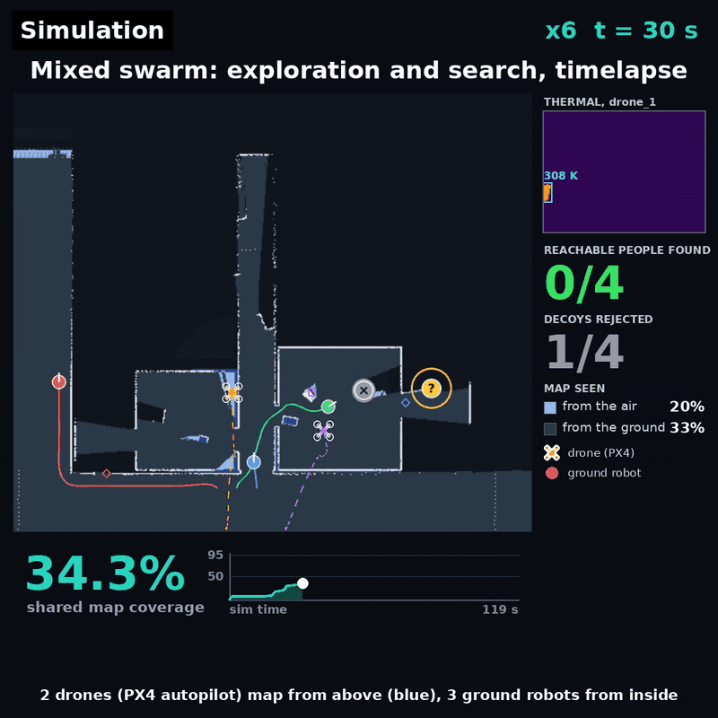
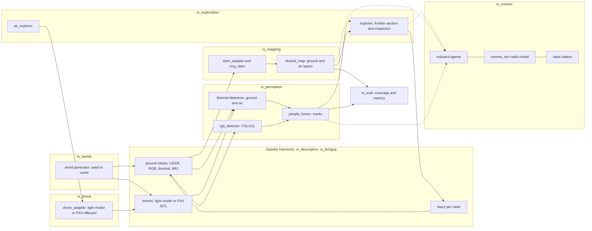
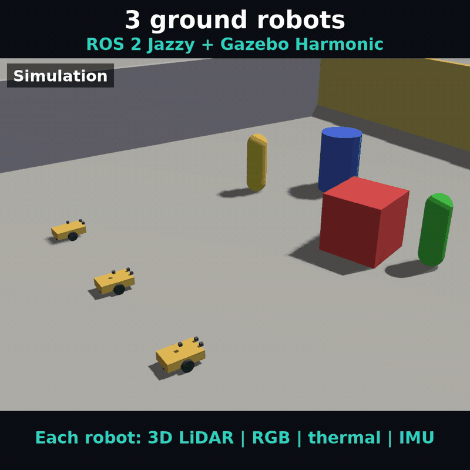
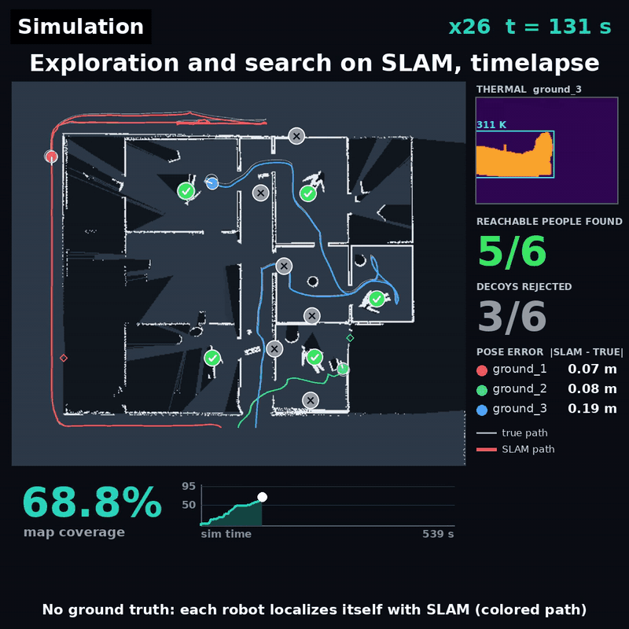

# RescueSwarm

A simulated swarm of ground robots and drones that explores a collapsed building, builds one shared map and finds people, with no human control.

[](https://github.com/bekaivision/rescueswarm/actions/workflows/ci.yml)




*Mixed swarm: 3 ground robots + 2 PX4 drones, visualization rendered from a recorded run.*

## What it does

- Generates collapsed-building worlds from a seed: corridor, rooms, dead ends, rubble, narrow passages, people and thermal decoys.
- Explores with frontier exploration and a decentralized auction. Every robot computes the same result, so there is no dispatcher. Nav2 drives each robot.
- Finds people with a thermal camera and LiDAR check, fuses marks from all robots (candidate, confirmed, rejected) and uses YOLO11 on RGB as a second cue.
- Replaces ground-truth poses with per-robot `mrg_slam` fused with wheel odometry and gyro. Graph exchange between robots and loop closures are off by default.
- Adds drones (own light flight model or PX4 SITL v1.17 in offboard mode) that map from above and spot warm targets; ground robots confirm up close.
- Routes all exchange through a radio model (range, walls, bandwidth, loss, delay, outages). Each robot keeps its own map; a base station shows what reached the rescuer.

## Highlights

Four generated worlds (seeds 1, 2, 3, 7), 19 reachable people in total. Details and caveats in [docs/RESULTS.md](docs/RESULTS.md).

| Question | Result |
| --- | --- |
| Mixed swarm vs 3 ground robots | 90 % coverage in 60 s vs 310 s; last person confirmed at 96 s vs 328 s |
| People search | 19/19 reachable people confirmed, 0 decoys confirmed |
| SLAM instead of ground truth | ATE rmse 0.26 m; map precision (2 cells) 0.70 vs 0.97 |
| Poor radio link | search takes 618 s instead of 158 s; base map coverage still 99.9 % |
| 140 s outage of one robot | it keeps mapping; base catches up 2 s after the link returns |
| Full stack (SLAM + 2 drones + medium link) | 19/19 people with light drones, 18/19 with PX4; 0 decoys |

All numbers are from simulation.

## Architecture



Packages: `rs_worlds` (world generator), `rs_description` (robot models), `rs_bringup` (launch files, Nav2 config), `rs_interfaces` (messages), `rs_exploration`, `rs_mapping`, `rs_perception`, `rs_drone`, `rs_comms`, `rs_eval`.

## Gallery



*Gazebo footage of the three ground robots.*



*SLAM trajectories against ground truth (rendered from recorded run data).*

## Quick start

Everything is built and run in Docker. Nothing is installed on the host. Needs Docker with the NVIDIA container runtime and an NVIDIA GPU (developed on an RTX 3060 Laptop, 6 GB), plus an X11 display for the windowed targets. The first image build is long (PX4 is compiled inside it).

```bash
make image                    # build rescueswarm-dev:jazzy
make deps                     # fetch external repos from deps.repos into external/
make build                    # colcon build inside the container
make explore SEED=1           # Gazebo + RViz, 3 robots explore a generated world
make explore-headless SEED=1  # same without windows
make search DRONES=2          # 3 ground robots + 2 light drones, Gazebo + RViz
make search-headless DRONES=2 DBACK=px4 LOC=slam COMMS=medium   # full stack, no windows
make check-phase5             # scripted check, ground only vs mixed swarm, results in results/phase-5/
```

Other checks: `make check-phase2`, `check-phase3`, `check-phase4`, `check-phase6`, `check-phase7a`. Run `make help` for all commands. The command help is in Russian.

## Repository layout

```
src/          ROS 2 packages (rs_*)
configs/      Gazebo worlds and settings
docker/       Dockerfile and compose file
patches/      patch for mrg_slam (not applied by default)
scripts/      evaluation, summaries, run helpers, video scripts
deps.repos    pinned external repositories
docs/         plan, phase reports, results
assets/brand/ logo (not covered by the code license)
```

## Testing

```bash
make test    # colcon test inside the container
```

About 299 unit tests. CI runs the pure-Python tests on a plain runner and the colcon tests in a `ros:jazzy-ros-base` container. Simulation checks (`make check-phase*`) need the full image and a GPU and do not run in CI.

## Project status

Phases 0-7a are done; Phase 7b (experiment series on swarm composition and size) is in progress.

| Phase | Content |
| --- | --- |
| 0 | Docker image with ROS 2 Jazzy, Gazebo Harmonic, GPU rendering |
| 1 | Three ground robots with LiDAR, RGB, thermal camera, IMU |
| 2 | Seeded world generator, shared map, frontier auction, Nav2 |
| 3, 3b | Thermal people search with decoys, YOLO11 as an extra cue |
| 4 | SLAM poses instead of ground truth |
| 5 | Drones (light and PX4), one shared map with ground and air layers |
| 6 | Radio model, per-robot maps, base station, outage test |
| 7a | Full stack, N=5, cleanup of the `comms_sim` bypass in `mrg_slam` |
| 7b | Experiment series (in progress) |

## Limitations

Simulation only. SLAM runs with loop closures off, no SLAM graph exchange between robots by default, and known start poses. Thresholds were tuned on the same four seeds the checks use; there are no held-out seeds yet. Few seeds, no statistical tests. Videos for Phases 2-6 are rendered from recorded run data, not screen captures. See [docs/RESULTS.md](docs/RESULTS.md#limitations).

## Docs

The plan and phase reports are in Russian.

- [Results](docs/RESULTS.md) (English)
- [Plan and research questions](docs/PLAN.md)
- [Phase 0](docs/PHASE_0_REPORT.md), [Phase 1](docs/PHASE_1_REPORT.md), [Phase 2](docs/PHASE_2_REPORT.md), [Phase 3](docs/PHASE_3_REPORT.md)
- [Phase 4](docs/PHASE_4_REPORT.md), [Phase 5](docs/PHASE_5_REPORT.md), [Phase 6](docs/PHASE_6_REPORT.md), [Phase 7a](docs/PHASE_7A_REPORT.md)

## License

AGPL-3.0-only. See [LICENSE](LICENSE) and [NOTICE](NOTICE) for third-party components. The RGB detector uses Ultralytics YOLO11 (AGPL-3.0). People in the simulation use the Rescue Randy model by Open Robotics, from [Gazebo Fuel](https://fuel.gazebosim.org/1.0/OpenRobotics/models/Rescue%20Randy/3), licensed CC BY 4.0, used unmodified.

## Author

Alibek Erkabayev ([bigalex95](https://github.com/bigalex95)), [Bekai Vision](https://bekaivision.github.io) ([GitHub](https://github.com/bekaivision)).
